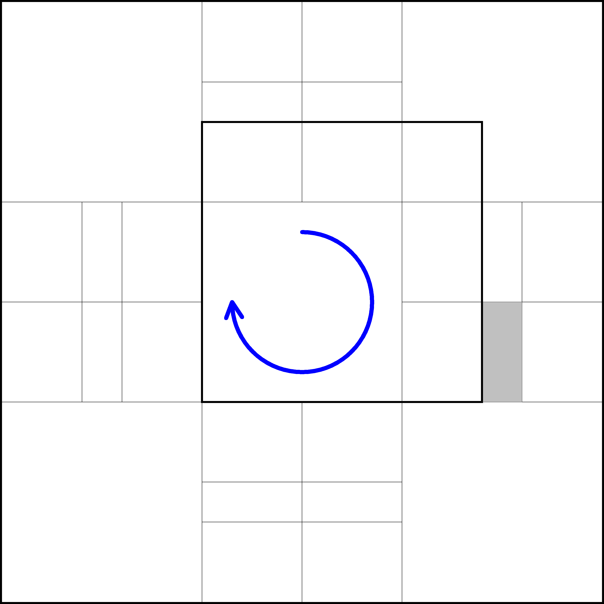
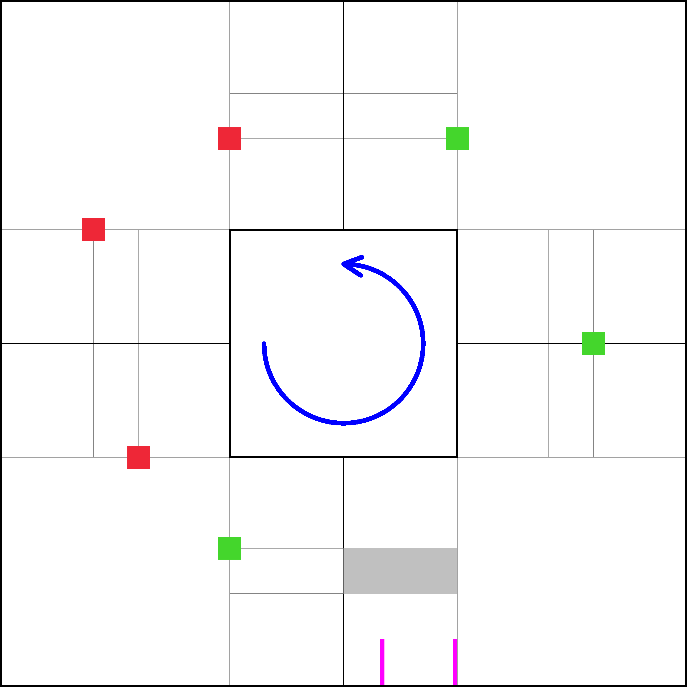

# WRO 2025 Future Engineers Randomization app

The web app simplifies the randomization process by preparing a picture with random layouts for both Open and Obstacle challenges:

- For the Open Challenge
  - the inner walls configuration
  - the starting zone

- For the Obstacle Challenge
  - the obstacles positions
  - the starting zone
  - the parking lot section

Examples of the pictures:

| Open Challenge | Obstacle Challenge |
|:----:|:----:|
|  |  |

## Run from CLI

- `sudo apt-get update`
- `sudo apt-get install -y libgl1-mesa-glx`
- `pip install -r requirements.txt`
- `gunicorn -w 2 app:app`
- open browser and go to `http://localhost:8000`

## Run by Docker

- `docker build -t fe-randomization-app .`
- `docker run -ti --rm -e HOST=0.0.0.0 -e PORT=8000 -p 8000:8000 fe-randomization-app`
- open browser and go to `http://localhost:8000`
